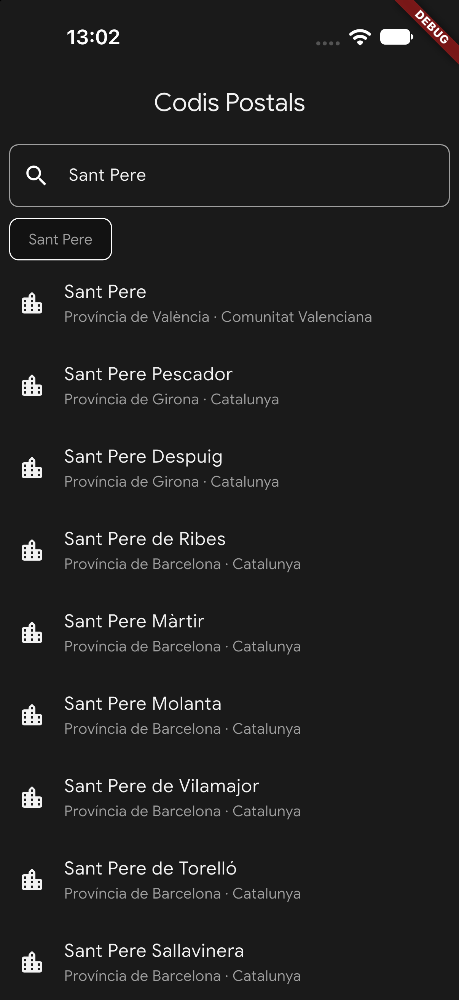
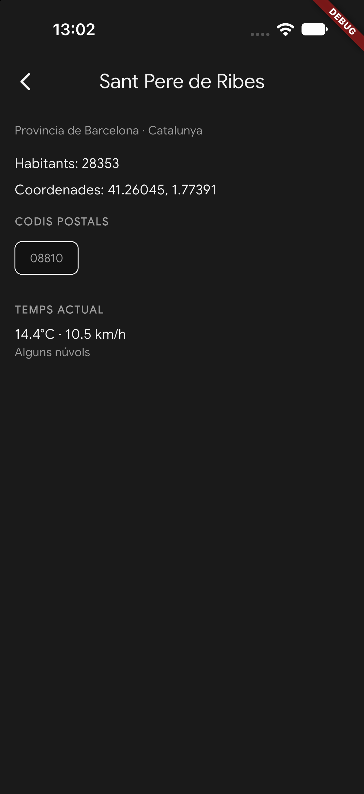

# 🐧 Codis Postals

Flutter app that searches Spanish localities by postal code or name, using the Open-Meteo geocoding API.

**Course:** Desenvolupament d'Aplicacions Mòbils per iOS i Android amb Flutter  
**Activity:** A1.4 — Una app amb API  
**Author:** Adrián Jaime Pastor

---

## What it does

- Enter a postal code → see which localities it belongs to
- Enter a locality name → see where it is
- Tap a locality → full detail: province, community, population, coordinates, all postal codes
- Live current weather at the selected locality
- Recent searches bar (last 5 successful queries, tappable)

## API

Data from the [Open-Meteo geocoding API](https://open-meteo.com/) — free, no key required, results in Catalan.

```
https://geocoding-api.open-meteo.com/v1/search?name=17820&language=ca&countryCode=ES
```

Weather:

```
https://api.open-meteo.com/v1/forecast?latitude=42.11667&longitude=2.76667&current=temperature_2m,weather_code,wind_speed_10m
```

Data source: Open-Meteo (CC BY 4.0), based on GeoNames.

## Project structure

```
lib/
├── main.dart
├── models/
│   ├── place.dart
│   ├── postcodes_response.dart
│   ├── weather_response.dart
│   └── weather_data.dart
├── screens/
│   ├── search_screen.dart
│   └── place_detail_screen.dart
├── services/
│   ├── postcode_service.dart
│   └── weather_service.dart
├── widgets/
│   ├── place_list_tile.dart
│   ├── weather_card.dart
│   ├── postcodes_wrap.dart
│   └── recent_searches_bar.dart
└── styles/
    └── app_styles.dart
```

## Levels completed

| Level | Description |
|-------|-------------|
| **Base** | Search screen with all 5 states: initial, loading, results, not found, error |
| **Ampliació** | Detail screen with full place data and postal code chips |
| **Repte** | Live weather on detail + recent searches bar |

## Screenshots

| Search | Detail |
|--------|--------|
|  |  |

## Reflection

Getting the app to handle all the edge cases the assignment asked for — a non-existent postal code returning no `results` key at all, places missing `population` or `postcodes` — was the first real challenge. Quicktype helped a lot but it only knows what you feed it, so I had to patch the null handling manually.

Separating the app into services, models, screens and widgets from the start made everything easier to reason about as it grew. Extracting `WeatherCard`, `PostcodesWrap` and `RecentSearchesBar` into their own files kept the screen files readable.

A few things surprised me: the `TextField` cursor and `CircularProgressIndicator` both defaulted to purple because they follow `colorScheme.primary`, which I hadn't set. One `colorScheme` line in `ThemeData` fixed both. Also learned the difference between `ActionChip` and `ChoiceChip` — they look similar but serve different purposes.
